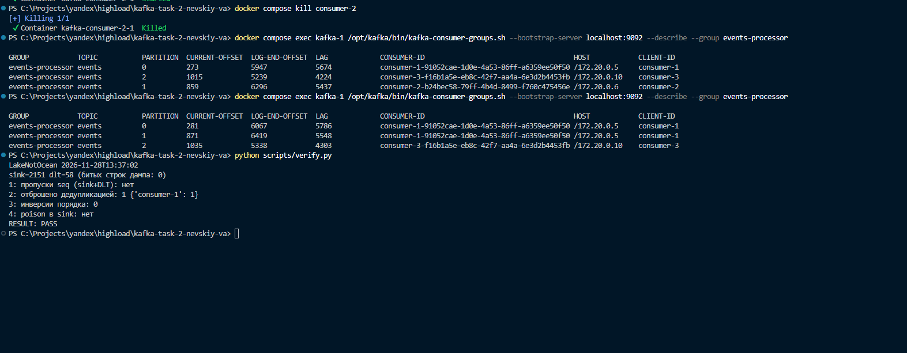
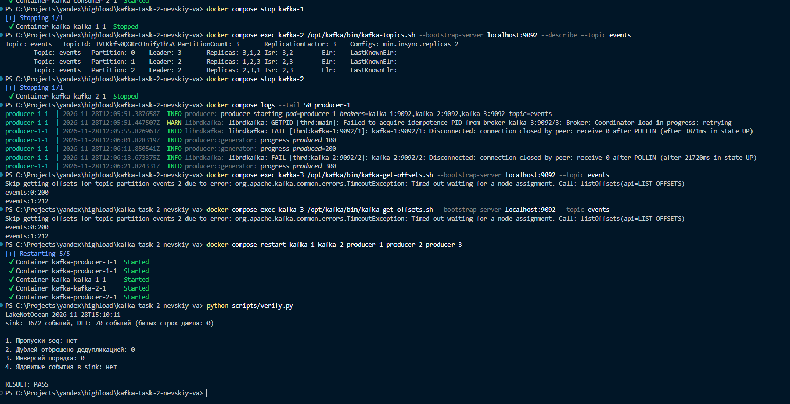
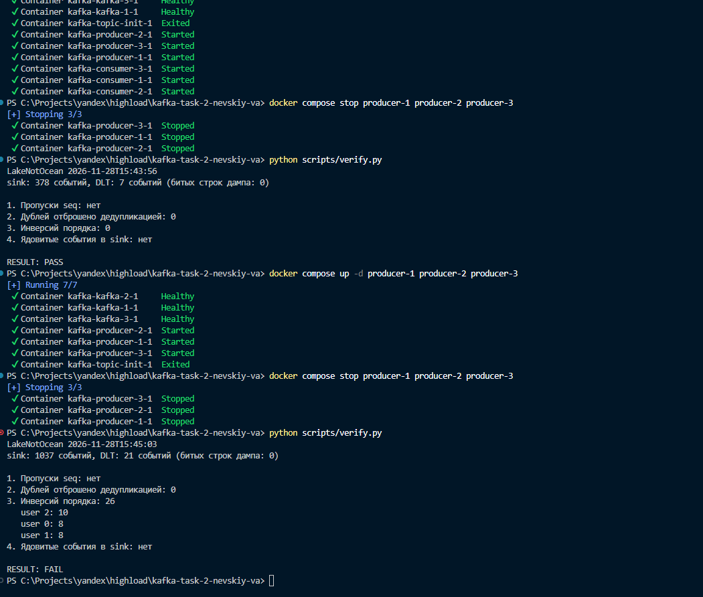

# Описание

Стенд содержит:

- Кластер Kafka из 3 брокеров (KRaft).
- 3 продюсера и 3 консьюмера на Rust.
- Общий sink для консьюмеров (SQLite).
- Продюсеры генерируют ядовитое событие на каждое 50-е событие. Консьюмеры отбраковывают такие сообщения в DLT.
- Скрипт для проведения экспериментов `python scripts/verify.py`. Описание экспериментов см. ниже.

# Запуск

```bash
cp .env.example .env
docker compose up -d --build
```

Первая сборка может занять несколько минут (librdkafka через cmake). После запуска
примерно через 10 с в логах продюсеров появятся строки генерации.

# Порты

| Компонент | Адрес |
| --- | --- |
| Kafka с хоста | партиции: `localhost:9094` / `9095` / `9096` (kafka-1/2/3) |
| Kafka внутри compose-сети | `kafka-1:9092,kafka-2:9092,kafka-3:9092` |
| Журналы продюсеров | `./data/producer-N.db` (bind-mount) |
| Sink консьюмеров | том `sink-data` (`/sink/sink.db` в контейнерах) |

# Топики

- `events`. 3 партиции с параметром `min.insync.replicas=2`. Основной топик для генерируемых продюсерами сообщений.
- `events.dlt`. Также 3 партиции для отбраковки ядовитых сообщений консьюмерами.

# Эксперименты

Проводятся под нагрузкой при работающей генерации.

## Эксперимент 1. kill -9 пода-консьюмера

### Гипотеза

После остановки пода координатор группы обнаружит пропажу по heartbeat через `session.timeout.ms` и инициализирует процесс ребаланса: партиция потерянного консьюмера перейдет к другому, который продолжит чтение с закоммиченного оффсета группы. События, которые ранее записал первый консьюмер в sink, но незакоммиченные (окно между записью и коммитом), приедут повторно и будут отброшены при проверке. Ожидается отсутствие пропусков seq, наличие отброшенных дублей (при условии незакоммиченных изменений на момент остановки) и отсутствие инверсий.

Для наглядности стоит добавить задержку между записью и коммитом `COMMIT_DELAY_MS`.

### Команды
```bash
# остановка пода
docker compose kill consumer-2
docker compose logs -f consumer-1 consumer-3
# проверка ребаланса
docker compose exec kafka-1 /opt/kafka/bin/kafka-consumer-groups.sh --bootstrap-server localhost:9092 --describe --group events-processor
# проверка результатов
python scripts/verify.py
```

### Результат
```
LakeNotOcean 2026-11-28T13:37:02
sink=2151 dlt=58 (битых строк дампа: 0)
1: пропуски seq (sink+DLT): нет
2: отброшено дедупликацией: 1 {'consumer-1': 1}
3: инверсии порядка: 0 
4: poison в sink: нет
RESULT: PASS
```

Гипотеза подтвердилась. Порядок не был нарушен, но, по причине задержки между записью и коммитом, консьюмер отбросил повторное сообщение.



## Эксперимент 2. Остановка одного, затем второго брокера с последующим восстановлением

### Гипотеза

После остановки первого брокера по алгоритму KRaft будет выбран новый лидер из оставшихся двух для партиции при необходимости. Продюсеры продолжат добавлять новые сообщения, а консьюмеры их читать. После потери второго брокера далее поддерживать кворум будет уже невозможно и добавление сообщений остановится. Записи будут копиться у продюсеров. После восстановления стенда обработки продолжится штатная обработка сообщений и не будет расхождений (если только сообщения не истекут).

### Команды
```bash
# остановка брокера
docker compose stop kafka-1
# убеждаемся, что партиции продолжают работать, есть новый лидер
docker compose exec kafka-2 /opt/kafka/bin/kafka-topics.sh --bootstrap-server localhost:9092 --describe --topic events
# остановка второго брокера
docker compose stop kafka-2
# потеря связи, оффсет не меняется, но сообщения продолжают генерироваться
docker compose logs --tail 50 producer-1
docker compose exec kafka-3 /opt/kafka/bin/kafka-get-offsets.sh --bootstrap-server localhost:9092 --topic events
# восстанавливаем стенд, перезапускаем продюсеры для повторной доставки сообщений
docker compose restart kafka-1 kafka-2 producer-1 producer-2 producer-3
# проверяем восстановление
python scripts/verify.py
```

### Результат
```
LakeNotOcean 2026-11-28T15:10:11
sink: 3672 событий, DLT: 70 событий (битых строк дампа: 0)

1. Пропуски seq: нет
2. Дублей отброшено дедупликацией: 0
3. Инверсий порядка: 0
4. Ядовитые события в sink: нет

RESULT: PASS
```

Гипотеза подтвердилась. После остановки второго брокера не удалось выбрать лидера для второй партиции, оффсет остался неизменным, а после перезапуска сообщения были повторно опубликованы продюсерами.



## Эксперимент 3. KEY_MODE=none против ключа user_id

### Гипотеза

Без ключа librdkafka раскидывает сообщения по партициям случайным образом и события одного пользователя попадают в разные партиции, а затем читаются разными подами параллельно. Так как глобального порядка между партициями нет, для пользователя меньший seq может быть записан в sink позже большего, в связи с чем возможна инверсия порядка для некоторых сообщений.

### Команды
```bash
# остановить стенд
docker compose down -v
# удалить содержимое data/

# установить USERS_PER_PRODUCER=1 в .env, иначе инверсии при интервале в 10 секунд не возникнет

# для запуска с KEY_MODE=user_id в .env
docker compose up -d

# подождать нагрузки

# остановить для исключения гонки данных при снятии дампа
docker compose stop producer-1 producer-2 producer-3 
# снять дамп, выполнить проверку
python scripts/verify.py            

# для запуска с KEY_MODE=none в .env
docker compose up -d producer-1 producer-2 producer-3

# остановить для исключения гонки данных при снятии дампа
docker compose stop producer-1 producer-2 producer-3 
# снять дамп, выполнить проверку
python scripts/verify.py         
```

### Результат

C KEY_MODE=user_id
```
LakeNotOcean 2026-11-28T15:43:56
sink: 378 событий, DLT: 7 событий (битых строк дампа: 0)

1. Пропуски seq: нет
2. Дублей отброшено дедупликацией: 0
3. Инверсий порядка: 0
4. Ядовитые события в sink: нет

RESULT: PASS
```

С KEY_MODE=none. Ошибка из-за инверсий.
```
LakeNotOcean 2026-11-28T15:45:03
sink: 1037 событий, DLT: 21 событий (битых строк дампа: 0)

1. Пропуски seq: нет
2. Дублей отброшено дедупликацией: 0
3. Инверсий порядка: 26
   user 2: 10
   user 0: 8
   user 1: 8
4. Ядовитые события в sink: нет

RESULT: FAIL
```

Гипотеза подтвердилась. При отсутствии привязки пользователя к партиции консьюмеры обрабатывали данные конкретного пользователя без гарантированного порядка.

